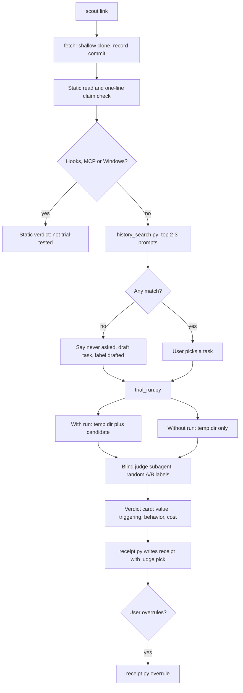

# Scout Trial Run - Plan

## Goal Capsule

- **Objective:** Give Scout a trial run. Scout tests a candidate skill on one of the user's real tasks, with and without the skill, and returns an evidence-based install verdict. This plan covers only the trial run. The other Scout v2 areas are not active scope.
- **Product authority:** Tural, the Scout author. Decisions were settled in the Oct 29 2026 brainstorm.
- **Open blockers:** None. Two questions are deferred to planning (see Outstanding Questions).

---

## Product Contract

### Summary

`scout <link>` takes a real task from the user's Claude Code history, or drafts one and labels it as drafted when nothing matches. It runs that task once with the candidate skill and once without, inside Claude Code's `/sandbox`. It returns a verdict card on value, triggering, behavior and cost. The user sees outputs A and B and can overrule the judge. Every trial writes a private receipt on the user's machine.

### Problem Frame

Today a user decides on a skill from its pitch, install counts and stars. None of these says whether the skill improves that user's work. One reviewer tested 20 popular Claude Code skills and found most did nothing. Tessl's docs say a registry review score does not show whether a skill improves output; only a with/without eval does. Anthropic's skill-creator can run a blind with/without comparison, but it is built for skill authors, not for someone deciding whether to install.

Scout v1 answers by reading: claims, overlap and a safety screen. Reading cannot show value. Static reading also has a safety ceiling: the CSA SkillCloak note reports that obfuscation and packing got past the eight scanners it tested 80-99% of the time, and it recommends runtime observation.

Users also lack a ready test task. When asked what task he would trial a recently scouted skill on, the Scout author could not name one. A trial that waits for the user to type a task will stall.

### Key Decisions

- **The trial task comes from the user's own history.** Real phrasing measures fit for this user, not for the skill's demo. Governs R1, R2. (session-settled: user-directed — chosen over drafting from the pitch or having the user type it: users freeze when asked for a task.)
- **When there is no history match, Scout says so, then drafts.** "You have never asked for this" is itself a finding: it marks the skill as new capability, not an upgrade. Governs R3. (session-settled: user-approved — chosen over stopping at "no match" or asking the user to type one.)
- **The judge decides first and the user can overrule.** This is fast by default, and the user's taste wins when they look. Governs R7, R8. (session-settled: user-approved — chosen over the user always judging blind or the judge deciding alone.)
- **The default trial is one task and one run each way.** It is cheap enough to use every time, and the verdict is honest that it rests on one run. Governs R5, R10. (session-settled: user-approved — chosen over three tasks by default or asking every time.)
- **Shape A plus local receipts.** The trial runs on demand, and each trial writes a receipt on the user's machine so a shared index stays possible later. Governs R13, R14. (session-settled: user-approved — chosen over shipping the public index in v1 or shipping without receipts.)
- **Candidate hooks never run in v1.** Hooks and MCP servers run outside `/sandbox` with full user access. Governs R6, R11. (session-settled: user-approved — chosen over running them during the trial.)
- **The name stays "scout".** The author's private exploration agent of the same name gets renamed instead. (session-settled: user-directed — chosen over renaming the skill.)

### Requirements

**Choosing the trial task**

- R1. Scout searches the user's local Claude Code session history for requests the candidate skill claims to help with, and shows the 2-3 best matches for the user to pick one.
- R2. Session history is read only on the user's machine. It is never written into receipts and never sent anywhere except the model calls the trial itself makes.
- R3. When no history request matches, the verdict states that the user has never asked for this kind of work. Scout then drafts one task from the skill's own description and labels it as drafted.

**Running the trial**

- R4. Scout installs the candidate into a throwaway location, separate from the user's real skill library, and removes it afterward.
- R5. By default Scout runs the chosen task once with the candidate skill available and once without it, both inside `/sandbox`.
- R6. Scout does not run the candidate's hooks or MCP servers. It lists them in the verdict with a plain description of what each would do.
- R7. A blind judge compares the two outputs without knowing which run had the skill, picks a winner or a tie, and gives a one-line reason.

**The verdict**

- R8. The verdict card shows outputs A and B, and the user can overrule the judge with one action. Any overrule is recorded in the receipt.
- R9. The verdict card reports four lines: value (which output won and why), triggering (whether the skill fired, and whether it displaced an installed skill), behavior (files read or written and network attempts during the run), and cost (extra tokens per use and any installed skill descriptions it would push out of the listing budget).
- R10. The verdict card states that the result rests on one run. When the judge calls it close or a tie, Scout offers a deeper trial.
- R11. When `/sandbox` is unavailable, or the skill's value depends on hooks or MCP servers, Scout does not run a trial. It returns a static read labelled "not trial-tested".
- R12. The v1 claim check stays, reduced to one line on the verdict card.

**Receipts**

- R13. Every trial writes a receipt on the user's machine: skill source and commit, model, task category, winner, any user overrule, and extra tokens. The task text is not included.
- R14. Receipts are never sent anywhere in this version.

### Acceptance Examples

- AE1. **Covers R1, R5, R7, R8.** Given a user who often asks Claude to write release notes, when they scout a release-notes skill, Scout offers their real release-notes requests to pick from, runs the trial, and shows A and B with the judge's pick. The user can flip the pick.
- AE2. **Covers R3.** Given a user who has never asked for market research, when they scout `last30days`, the verdict says "You have never asked for this. This is new capability, not an upgrade." The trial then runs on a task marked as drafted.
- AE3. **Covers R6, R11.** Given a skill whose main effect is a hook that runs on every prompt, Scout runs no trial. It returns a static read labelled "not trial-tested" and describes what the hook would do.
- AE4. **Covers R10.** Given the judge calls the result a tie, the verdict states it rests on one run and offers a deeper trial. It does not present the tie as a final skip.

### Success Criteria

- First checkpoint: Scout trial-runs three skills the author already has a view on, one that helps, one suspected redundant and one probably obsolete. Its verdict matches the author's view on at least two.
- A default trial finishes in about 3 minutes.
- Abort condition: 1 hour or 3 failed attempts on the trial mechanism, whichever comes first. At that point, stop and reassess.

<!-- ce-section: work-relationships -->
### How This Work Fits Together

This plan owns the trial run. The breakdown below is current understanding, not a committed roadmap.

- `scout for <task>`: search marketplaces, shortlist three, trial each. Depends on the trial run.
- Re-scout after model upgrades: re-run trials for installed skills and flag the ones the base model has made obsolete. Depends on the trial run and its receipts.
- `scout.lock`: pin the trialled commit, then diff and re-trial on update. It can double as a team approved list. Shares the receipt as its record of what was trialled.
- Codex support for the trial run: one Scout, not a fork. The v1 skill already loads in Codex through `~/.agents/skills`. The trial needs a second runner behind the same `trial_run.py` interface, using `codex exec` with its own sandbox and `--ephemeral`, plus history search over `~/.codex/sessions`. Depends on the trial run.
- Public receipt index: opt-in sharing of receipts so skills can be ranked by trial outcomes. Depends on receipts (R13). Still to decide: the privacy model.

### Scope Boundaries

- The four areas above are deferred.
- Moving Scout into its own repository and renaming the author's private `scout` agent are separate work.
- Container-level isolation that would allow hooks to run is deferred.
- Judging several tasks by default is out of scope; one task is the default (per R5).

### Dependencies / Assumptions

- Claude Code's `/sandbox` is available on macOS and Linux and not on native Windows. It does not cover hooks, MCP servers, or the built-in file and web tools (per its docs). R11 handles the gaps.
- Local Claude Code session history can be read and matched to a skill's description well enough to pick useful tasks. This has not been tested.
- The blind-judge pattern comes from the author's existing `eval-skills` skill and Anthropic's skill-creator comparator.

### Outstanding Questions

Both planning questions are answered: firing and displacement by KTD3, the fair baseline by KTD2.

### Sources / Research

- Snyk ToxicSkills audit: https://snyk.io/blog/toxicskills-malicious-ai-agent-skills-clawhub
- CSA SkillCloak note: https://labs.cloudsecurityalliance.org/research/csa-research-note-skillcloak-agent-skill-evasion-20260706-cs/
- Tessl, review score vs evals: https://docs.tessl.io/improving-your-skills/reviewing-skills
- Skill-creator with/without benchmark (secondary source): https://pasqualepillitteri.it/en/news/341/claude-code-skills-2-0-evals-benchmarks-guide
- Claude Code sandboxing: https://code.claude.com/docs/en/sandboxing
- Skill listing budget: https://claudefa.st/blog/guide/mechanics/skill-listing-budget
- Current Scout skill: `skills/scout/SKILL.md`

**Preservation note.** R5 says the runs happen "inside `/sandbox`". Planning keeps that intent and makes it stricter: each run is a headless `claude -p` with sandboxing turned on through `--settings`, plus `--restricted` (see KTD1). This is a clarification of R5, not a change.

---

## Planning Contract

### Context and Research

- The repo is a single skill: `skills/scout/SKILL.md` (v1, prose-only), `README.md` and `LICENSE`. It has no scripts, tests or CI yet.
- Claude Code 2.1.261 headless flags that matter here: `-p`, `--output-format stream-json`, `--no-session-persistence`, `--strict-mcp-config`, `--settings <json>`, `--add-dir`, `--model`, `--tools`, `--restricted`.
  - `--restricted` drops Bash, code-running tools and WebFetch unless `--tools` names them. It ignores user, project and local settings files, and confines file tools to the working directories. `--settings` and managed settings still apply.
  - `--bare` is not used because it needs `ANTHROPIC_API_KEY` and most users sign in with a subscription.
- Transcripts live at `~/.claude/projects/<project>/*.jsonl`, one JSON object per line. A real user prompt has `type == "user"`, `isSidechain == false` and a string `message.content`. Command wrappers and system notices also arrive as user lines and start with tags such as `<command-name>` or `<system-reminder>`.
- Blind judging follows the existing `eval-skills` skill: a fresh subagent sees two outputs under neutral labels and the task, never which run had the skill.

### Key Technical Decisions

- KTD1. **Each trial run is a headless `claude -p` call in its own temp directory, with `--restricted`, `--tools Read,Glob,Grep,Edit,Write,Bash,Skill`, `--permission-mode acceptEdits`, `--settings '{"sandbox":{"enabled":true}}'`, `--strict-mcp-config` and `--no-session-persistence`.** Restricted mode keeps the candidate away from user hooks, WebFetch and files outside the temp directory. `--tools` turns Bash back on so script-backed skills can work, and the sandbox confines it. `acceptEdits` lets writes happen without a human, and restricted mode keeps them inside the temp directory. Probed Oct 29 2026 on CLI 2.1.261: all flags exist and restricted mode refuses `bypassPermissions`. This instantiates the hooks/MCP Key Decision and R5. (session-settled: user-approved — chosen over plain `/sandbox` in the live session: hooks, MCP servers and the file and web tools are not covered by `/sandbox`.)
- KTD2. **Skills reach the runs as session plugins through `--plugin-dir`.** A probe on Oct 29 2026 showed that restricted mode loads only built-in skills: project skills under `.claude/skills/` and the user's own skills do not load. A plugin passed with `--plugin-dir` does load, namespaced as `<plugin>:<skill>`. So both runs get a "baseline" plugin built from copies of the user's personal skills (`~/.claude/skills/*`, symlinks resolved, the candidate's name excluded). The "with" run also gets a "candidate" plugin. This gives a fair baseline and makes displacement measurable. Plugin-provided skills from the user's settings are not included; the verdict labels displacement as "personal skills only". All temp directories are deleted in a `finally` block. Governs R4, R9.
- KTD3. **"Fired" means a `tool_use` event for the Skill tool naming the candidate in the "with" run's stream-json.** Skill names are compared after stripping the `<plugin>:` prefix. "Displaced" means a different skill fired in the "without" run and that skill did not fire in the "with" run. Tokens come from the stream-json `result` event's usage. Governs R9.
- KTD4. **Session history stays inside a local Python script that prints only the 2-3 chosen prompts to the agent.** Ranking is plain keyword overlap with the skill's description, with no model call. Governs R1, R2.
- KTD5. **Hooks/MCP gate runs before any install.** The script looks for `hooks` in SKILL.md frontmatter, `hooks/hooks.json`, `.mcp.json` and `hooks`/`mcpServers` in `plugin.json`, and also lists plugin `agents/` and `commands/`. Hooks and MCP servers are never copied into a trial plugin, so they never run (R6). The script cannot tell whether a skill's value depends on them (R11), so it reports what it found and the agent decides: when the SKILL.md body tells the model to rely on a hook or MCP tool, Scout goes to the static read; otherwise the trial runs and the verdict lists the skipped parts. Native Windows, or a sandbox that fails to start, also routes to the static read. Governs R6, R11.
- KTD6. **Scripts are stdlib-only Python 3 and tests use `unittest`.** No install step for users and no dependencies to vet, which matters for a tool whose job is distrust. A fake `claude` executable, chosen with the `SCOUT_CLAUDE_BIN` environment variable, lets tests run without a model.
- KTD7. **Receipts are JSON files under `~/.scout/receipts/`, overridable with `SCOUT_HOME`.** The writer takes a fixed set of fields and validates every value: task category is a fixed list (for example `writing`, `code`, `research`, `review`, `data`, `ops`, `other`), source must be a URL, commit a hex SHA or `unknown`, winner `with`/`without`/`tie`, tokens an integer. A free-text value can't get in, so task text can't leak by accident. Governs R2, R13, R14.
- KTD8. **R2's allowed model calls are the parent Scout session, the two trial runs and the judge.** History matches show prompt text and a timestamp only, never a project path. The task travels on stdin, so no task file is left on disk. Trial runs are not `--bare`, so the user's global CLAUDE.md loads in both runs; that is the same in both and stays within R2. Governs R2.

### High-Level Technical Design

This is directional, not a spec.

---

## Implementation Units

- U1. **History search**
  - **Goal:** Find the user's own past requests that match a skill description (R1, R2, R3).
  - **Files:** `skills/scout/scripts/history_search.py`, `tests/test_history_search.py`, `tests/fixtures/projects/`.
  - **Approach:** Walk `~/.claude/projects/*/*.jsonl` (root overridable by flag for tests). Keep non-sidechain user lines with string content. Drop lines starting with a tag (`<command-`, `<system-reminder>`, `<local-command`, `<task-notification>`), very short lines, duplicates, and lines that invoke scout or contain the candidate's source URL. Score by keyword overlap with the description, minus stopwords. Print JSON: `{"matches": [{"text", "timestamp"}], "searched": n}`, with no project path. Truncate each text to about 400 characters. Unreadable or malformed lines are skipped.
  - **Test scenarios:** matches a relevant prompt and ranks it above an unrelated one; skips sidechain, tag-wrapped and list-content lines; dedupes repeats; returns empty matches with no error when nothing scores; survives a malformed JSON line; respects the limit of 3; drops a line that is the user's own scout command. Fixtures are hand-written synthetic JSONL, never copied from real transcripts, because the repo is public.

- U2. **Trial runner**
  - **Goal:** Run the task with and without the candidate, safely, and report what happened (R4, R5, R6, R9, R11).
  - **Files:** `skills/scout/scripts/trial_run.py`, `tests/test_trial_run.py`, `tests/fake_claude.py`.
  - **Approach:**
    - Subcommand `fetch <link>`: shallow `git clone` into a temp dir, prints the dir and the HEAD SHA. GitHub tree URLs map to repo plus sub-path. The caller removes the dir with `cleanup <dir>` at the end of the flow.
    - Subcommand `check <skill-dir>`: the KTD5 scan plus platform check. Prints `{"platform_ok": bool, "hooks": [...], "mcp": [...], "agents": [...], "commands": [...]}`.
    - Subcommand `run <skill-dir> [--model]`, task on stdin: refuses if `check` fails. Creates temp dirs, builds the baseline and candidate plugins (KTD2, hooks and MCP files left out), runs the CLI from `SCOUT_CLAUDE_BIN` or `claude` with the KTD1 flags and a timeout, parses stream-json, snapshots each work dir before and after to list files written, and deletes everything in `finally`.
    - Output JSON per run: final text, skills fired, tokens in and out, files read (from Read tool calls), files written, network attempts (Bash commands with `curl`, `wget`, `http`, plus sandbox denials in tool results), exit status. Plus `fired`, `displaced` and `extra_tokens`.
    - The task arrives on stdin and is passed to the CLI on stdin, never on a command line, so it does not show up in process listings and leaves no file behind.
  - **Test scenarios:** `check` flags frontmatter hooks, `hooks/hooks.json`, `.mcp.json` and plugin `mcpServers`; `check` passes a plain skill; `run` with the fake CLI parses fired skills, tokens and final text; the candidate exists only in the "with" dir; both temp dirs are gone after success and after a CLI failure; a timeout returns an error result rather than hanging; the command line holds the restricted, `--tools` with Bash, `acceptEdits`, sandbox and strict-MCP flags; the baseline plugin excludes the candidate's name; `fetch` parses a GitHub tree URL.

- U3. **Listing cost**
  - **Goal:** Show what the candidate costs in the skill listing budget (R9 cost line).
  - **Files:** `skills/scout/scripts/listing_cost.py`, `tests/test_listing_cost.py`.
  - **Approach:** Read name and description from each installed `SKILL.md` under `~/.claude/skills` (overridable) and from the candidate. Report total description characters before and after, the candidate's share, and, when the total passes a budget estimate, the installed skills whose descriptions would fall past it (ordered as a plain estimate; Claude Code drops least-used first, which Scout cannot see). The budget is a flag with a default near 1% of a 200K-token context in characters, labelled as an estimate.
  - **Test scenarios:** parses quoted and plain frontmatter descriptions; skips folders without SKILL.md; reports the candidate's added characters; flags when the total passes the budget and names the skills past it.

- U4. **Receipts**
  - **Goal:** Keep a private local record of every trial (R8, R13, R14).
  - **Files:** `skills/scout/scripts/receipt.py`, `tests/test_receipt.py`.
  - **Approach:** `write` takes the allowed fields as flags (source, commit, model, task category, task origin of history or drafted, winner, extra tokens), validates each per KTD7, and writes one JSON file named by timestamp and skill. `overrule <file> --winner` updates the winner and records the judge's original pick. No network code anywhere.
  - **Test scenarios:** writes under `SCOUT_HOME`; contains only allowed keys; an unknown field is refused; a task category outside the list is refused; a non-URL source is refused; overrule keeps the judge's pick and the user's pick.

- U5. **Scout flow in SKILL.md**
  - **Goal:** Turn the v1 read-only flow into the trial flow (R1-R12).
  - **Files:** `skills/scout/SKILL.md`.
  - **Approach:** Keep the v1 safety screen and the private-verdict rule. Order: fetch and static read, one-line claim check, `trial_run.py check`, history search and task pick (or "never asked" then drafted task), `trial_run.py run`, blind judge subagent with labels shuffled, verdict card, `receipt.py write` with the judge's pick, overrule question, `receipt.py overrule` only if the user flips it, `trial_run.py cleanup`. Spell out the verdict card format, the one-run caveat and deeper-trial offer, and the static "not trial-tested" path. Update the description so it triggers on "try this skill" and "does this skill help me", and drop the stale Distill sentence if any remains.
  - **Test scenarios:** None automated. Checked by a dry read against AE1-AE4 and by the first-checkpoint trial in the Verification Contract.

- U6. **README and CI**
  - **Goal:** Make the repo usable and keep the scripts honest (R2, R14 stated publicly).
  - **Files:** `README.md`, `.github/workflows/test.yml`.
  - **Approach:** README leads with "proof, not pitch", shows a sample verdict card, lists requirements (macOS or Linux, Claude Code CLI, python3) and states the privacy rules in plain words. CI runs `python3 -m unittest discover tests` on ubuntu and macOS.
  - **Test scenarios:** CI passes on the PR.

---

## Verification Contract

- `python3 -m unittest discover tests` passes locally and in CI.
- `trial_run.py check` run against a real hook-carrying plugin and a plain skill gives the right answer.
- One real `trial_run.py run` against a small installed skill completes, cleans up both temp dirs, and reports fired, tokens and files. If the CLI or sandbox is unavailable on the machine, record that and rely on the fake-CLI tests.
- Nothing in `~/.scout/receipts/` contains task text.
- Committed fixtures contain no real prompts, project paths or usernames.

## Definition of Done

- U1-U6 landed on `feat/trial-run` with passing tests.
- SKILL.md describes the full trial flow and the static fallback.
- A PR is open on `iamtural/scout` with CI green.
- The first-checkpoint run on three known skills is listed as the next step, not claimed.
